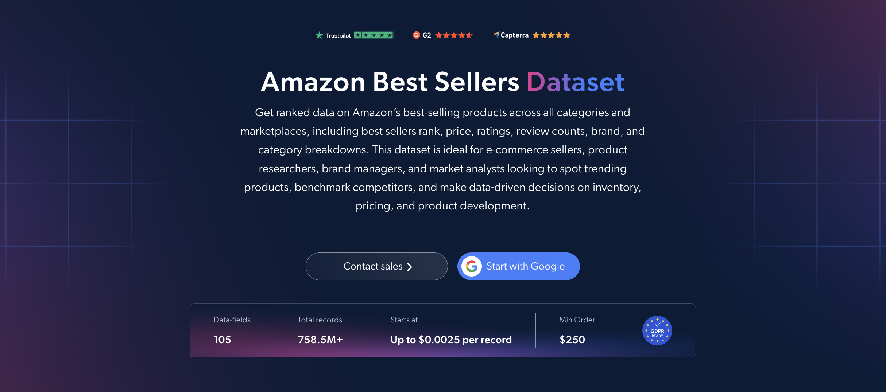

# Amazon-Best-Sellers-dataset-samples

<h2>A sample dataset of 1000 Amazon best-selling products</h2>

<a href="https://brightdata.com/products/datasets/amazon/best-sellers">
   
</a>

An Amazon best sellers dataset sample of 1000 products. Dataset was extracted using the <b>Bright Data API</b>.

<h2>Some of the data points that are included in the dataset:</h2>

* ```url```: URL of the Amazon product page
* ```asin```: Amazon Standard Identification Number of the product
* ```title```: Title of the product
* ```brand```: Brand of the product
* ```seller_name```: Name of the seller
* ```description```: Description of the product
* ```initial_price```: Original price of the product
* ```final_price```: Current or discounted price of the product
* ```currency```: Currency of the product price
* ```discount```: Product discount information
* ```availability```: Availability of the product
* ```rating```: Average customer rating
* ```reviews_count```: Number of product reviews
* ```categories```: Categories associated with the product
* ```root_bs_rank```: Best sellers rank in the top-level category
* ```root_bs_category```: Top-level best sellers category
* ```bs_rank```: Best sellers rank in the specific category
* ```bs_category```: Specific best sellers category
* ```subcategory_rank```: Best sellers rank entries by subcategory
* ```badge```: Product badge, such as #1 Best Seller or Amazon's Choice
* ```bought_past_month```: Purchase volume shown by Amazon for the past month
* ```variations```: Available product variations
* ```image_url```: URL of the main product image
* ```domain```: Amazon marketplace domain

And a lot more.

This is a sample subset which is derived from the "Amazon Best Seller Products (public data)"
dataset which includes more than <b>171,700,000 product records</b>.

Available dataset file formats: <b>JSON, NDJSON, JSON Lines, CSV, XLSX, or Parquet. Optionally, files can be compressed to .gz</b>.

Dataset delivery type options: <b>Email, API download, Webhook, Amazon S3, Google Cloud storage, Google Cloud PubSub, Microsoft Azure, Snowflake, SFTP</b>.

Update frequency: <b>Once, Daily, Weekly, Monthly, Quarterly, Biannual, or Custom basis</b>.

Data enrichment available as an addition to the data points extracted: <b>Based on request.</b>

<b>[Get the full Amazon Best Sellers dataset](https://brightdata.com/products/datasets/amazon/best-sellers)</b>.

<a href="https://brightdata.com/products/datasets/amazon/best-sellers">
</a>

<h2>What are the Amazon Best Sellers datasets use cases?</h2>

<h3>1. Product discovery and trend tracking</h3>
Retailers and product researchers use Amazon best sellers datasets to identify top-ranked products across categories. Comparing category rankings, ratings and purchase-volume indicators helps validate product ideas, while recurring dataset updates reveal rank movements and emerging trends.

<h3>2. Competitor and category analysis</h3>
Brands analyze which sellers and brands occupy leading positions within each category. Comparing rankings, prices and review counts across Amazon marketplaces helps assess the competitive landscape and identify potential niches for sourcing and product development.

<h3>3. Pricing and inventory strategy</h3>
E-commerce teams benchmark prices against best-selling products and monitor discounts, availability and product variations. These insights support competitive pricing, assortment planning and promotion timing, with category rankings providing additional context for inventory decisions.

<h2>Free access to web scraping tools and datasets for academic researchers and NGOs</h2>

The Bright Initiative offers access to Bright Data's <b>[Web Scraper APIs](https://brightdata.com/products/web-scraper)</b> and <b>[ready-to-use datasets](https://brightdata.com/products/datasets)</b> to leading academic faculties and researchers, NGOs and NPOs promoting various environmental and social causes. You can submit an application <b>[here](https://brightinitiative.com)</b>.
